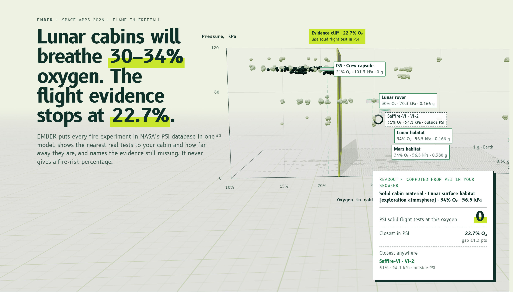

# EMBER — Evidence Map for Burn & Extinction Risk

**NASA Space Apps Challenge 2026 · “Flame in Freefall”**

> Every NASA fire experiment in one place — and the line where the evidence ends.



None of the 261 solid-material flight tests with measured oxygen in NASA’s Physical Sciences Informatics (PSI) repository ran above **22.7% O₂** (outside PSI, Saffire-VI burned one cloth sample at 31% O₂ and 54 kPa in 2024, [NTRS 20240002981](https://ntrs.nasa.gov/citations/20240002981)), and all ran near 98–102 kPa. Lunar cabins plan **30–34% O₂ at 56–70 kPa**. EMBER shows a spacecraft fire-safety engineer which NASA investigations apply to their cabin, the nearest real tests and how far away they are, and which flight test would close the gap. It never gives a fire-risk percentage.

- **Live site:** https://itsamirkhon.github.io/EMBER/ (static, no login, no API key)
- **Project page text, NASA data list, Use of AI, references, video script:** [`ember-final/docs/SUBMISSION_2026.md`](ember-final/docs/SUBMISSION_2026.md)

## The screens

| Route | Screen |
|---|---|
| `#/` | 3D intro (flame at 1 g vs microgravity, then a lunar cabin) and the finding |
| `#/map` | Evidence map: all tests by O₂ × pressure with mission atmospheres and the evidence cliff |
| `#/lens` | Mission lens: environment, task, material → *Measured* / *Data nearby* / *Beyond the evidence*, three ranking scales, nearest real tests with axis gaps, next experiment |
| `#/ask` | Ask EMBER: cited answers; ten pre-computed answers work without a server |
| `#/investigations`, `#/compare`, `#/export` | Cards for the 15 investigations, protocol comparison, CSV/JSON with source row for every record |
| `#/earth`, `#/trust` | Back to Earth (NASA Spinoff) and the self-check page (backtest vs baseline, claim checks, limits) |

## Run it

The active project is **[`ember-final/`](ember-final/)**.

```sh
cd ember-final
npm install
npm run dev          # site + optional API at the printed URL
npm test             # 187 core, regression and API tests
npm run test:intro   # 36 tests for the 3D intro's evidence gate
npm run build        # static site in dist/ (what GitHub Pages serves)
```

Without keys everything runs in the browser. With a server-side `.env` (see `ember-final/.env.example`), the Node API adds live retrieval decisions and model-written answers; secrets never reach the frontend.

Rebuild the derived data after a corpus change: `npm run data:compact`, `npm run data:trust`, `npm run intro`, and (paid, needs `OPENAI_API_KEY`) `npm run data:ask`.

## More

- [Technical README](ember-final/README.md) · [Implementation status](ember-final/docs/IMPLEMENTATION_STATUS.md) · [Interpret status](ember-final/docs/INTERPRET_STATUS.md)
- Older prototypes (`web/`, `ember-win/`) are kept for reference; `ember-final/` is the submission.

Data: NASA PSI (CC0 for reviewed records) and NTRS. Not an official NASA product and not a certification tool. License: GPL-3.0.
