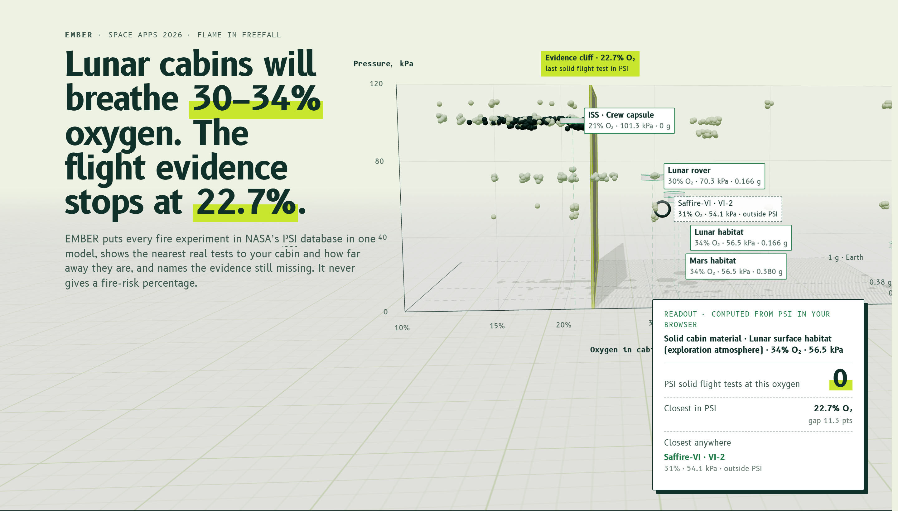

# EMBER design direction: Oxygen Green

## Why this look

Both projects we found arguing the same point for this challenge (SPICA "The 34% Question" and MicroFire Atlas) went dark: a black starfield, navy glow, and AI-generated space art. A judge scrolling through finalists sees that look again and again. EMBER goes the other way and borrows from the bench of the engineer it is built for, not from outer space.

- **Ground: the engineering computation pad.** That's the pale green gridded paper engineers do hand calculations on. The whole site sits on it, and the 3D model stands on it like a physical model on a desk.
- **Ink: pine, a green-black.** Not charcoal and not pure black.
- **Action: oxygen-cylinder green.** US gas-cylinder colour coding marks medical oxygen bottles green, so the one colour you click is the colour of the gas the whole argument is about.
- **One highlight: highlighter chartreuse.** It's the marker an engineer drags across the line that matters. It appears in exactly one role, the evidence cliff and the gap past it, and the empty region beyond the cliff is drawn as drafting hatch.
- **Type: B612.** Airbus designed it for cockpit displays, where legibility under stress is the whole job. B612 Mono is kept for uppercase instrument labels; figures use B612 with tabular digits.

No fire colours in the interface, no blue, no charcoal, no glass, no gradients-as-decoration. The only flame colours on the site are inside the flame chamber, where they are the physics: a yellow buoyant flame at 1 g and a blue sphere in orbit.

## Tokens

| Role | Token | Value |
|---|---|---|
| Ground (pad) | `--v3-bg` | `#eef2e2` |
| Pad grid | `--v3-grid` | `#d5e0c3` |
| Sheet / card | `--v3-surface-2` | `#fbfcf6` |
| Ink | `--v3-text` | `#10302a` |
| Ink, secondary | `--v3-text-2` | `#3e5a50` |
| Action (O₂ green) | `--v3-accent` | `#1e7a46` |
| Highlight (cliff only) | `--v3-cliff` | `#c8e62e` |
| Highlight text on pad | `--v3-cliff-text` | `#3d5200` |
| Solid / liquid / gas data | `--v3-solid` / `--v3-liquid` / `--v3-gas` | `#10302a` / `#2e8a7c` / `#8a9a2a` |

Phases are also coded by shape (circle, diamond, triangle), so the charts still read in greyscale.

## Rules

1. **One highlight per screen, and it means "the evidence ends here."** It's never used for decoration, warnings or brand.
2. **Status by shape and fill, not hue alone.** *Historical match* is solid green, *Related records* is an outlined chip, and *No matching flight test* is highlighter.
3. **Drafted controls.** Square corners, 1 px ink rules, and a hard offset shadow on hover, the way a sheet of paper lifts off a pad.
4. **Motion in three places only:** the hero camera reveal, the step tour across the cliff, and the verdict appearing. Everything else stays still. `prefers-reduced-motion` turns all of it off.
5. **Every number is computed or cited.** The hero readout is calculated from PSI in the browser. Saffire-VI (31% O₂, 54.1 kPa, 2024) is drawn as an annotation from outside PSI, linked to NTRS 20240002981, and never mixed into the corpus.

## 3D model

- **What it plots:** every PSI test with oxygen and pressure, by oxygen (log scale), pressure and gravity. All tests stand on the 0 g wall.
- **Lighting:** a soft studio light with real shadows on the pad.
- **The cliff:** a translucent chartreuse acrylic sheet at 22.7% O₂, with drafting hatch on the floor beyond it.
- **Planned cabins:** wireframe pucks hovering at their oxygen, pressure and gravity, with drop lines down to the pad.
- **Tour:** three camera stops: every flight test, the cliff, and where crews are going.
- **Without WebGL:** the 2D evidence map replaces it.
